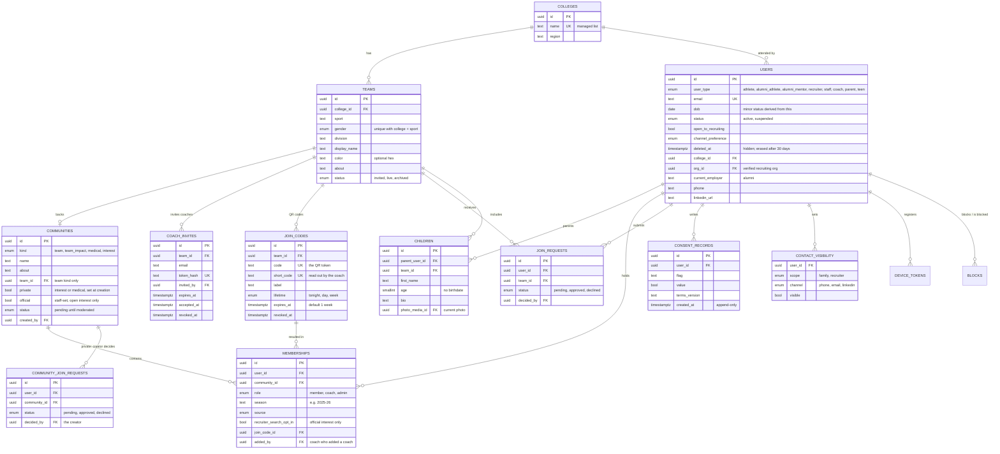
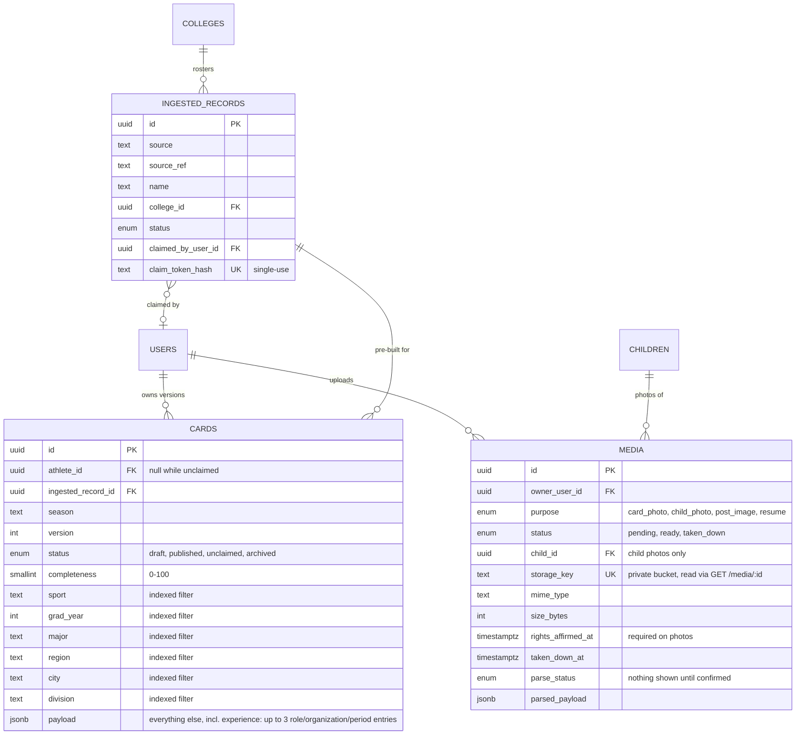
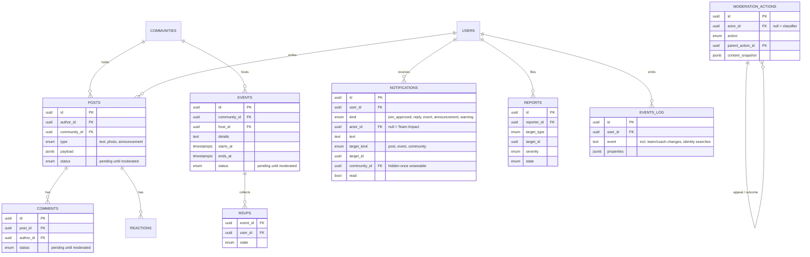
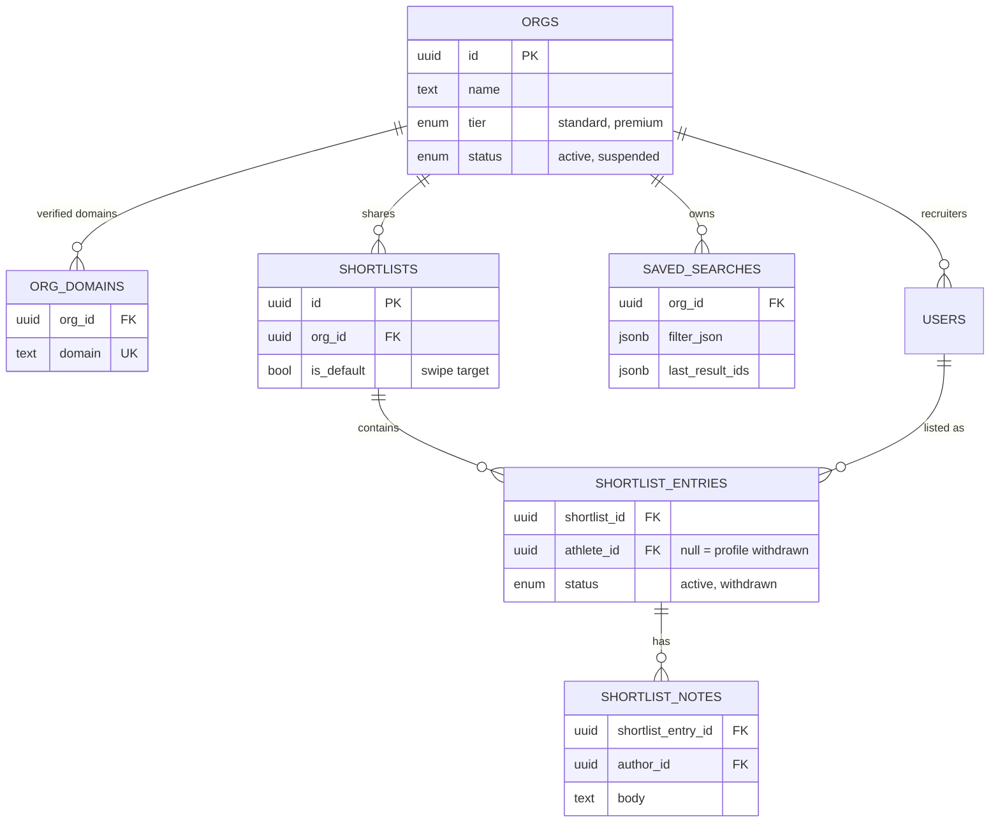

# Data model

The schema TI-14 implements: the TI-4 v2 model (PRD v2, see the TI-4 v2 validation doc) plus PRD
v2.1 team onboarding (TI-148/TI-149) and PRD v2.3 communities (migration `0002_communities`).
**32 tables.** Source of truth is
`apps/api/src/db/schema/`; this page explains it. If you change the schema, update the diagrams here.

## How the count gets to 32

| Step                                                                                                 | Tables |
| ---------------------------------------------------------------------------------------------------- | ------ |
| Original TI-4 model                                                                                  | 23     |
| + `device_tokens`, `shortlist_notes` (first TI-4 pass)                                               | 25     |
| + `children`, `join_codes`, `join_requests`, `blocks`, `org_domains`, `contact_visibility` (TI-4 v2) | 31     |
| − `seats`, `contact_requests` (gone in PRD v2)                                                       | 29     |
| + `coach_invites` (PRD v2.1); `schools` renamed `colleges`                                           | 30     |
| + `community_join_requests`, `notifications` (PRD v2.3); `groups` renamed `communities`              | **32** |

Identity-search auditing is an `events_log` event (`search.identity_filter`), not its own table.

## Rules the schema enforces

- **No health data, no minor flag.** No column stores a condition, diagnosis, injury or `is_minor`.
  Minor status is derived from `users.dob`.
- **Children never log in and have no birthdate.** They are rows in `children` (age only), owned
  by a parent user, never rows in `users`.
- **Consent is history, not a boolean.** `consent_records` is append-only; a flag's current value is
  its newest row.
- **Seasons.** `memberships.season` and `cards.season` let roster dedupe (TI-36) resolve one athlete
  across years. Cards are versioned (`season`, `version`).
- **Moderation first.** `posts`, `comments`, `events` and `communities` default to
  `status = pending`.
- **Community shape.** Check constraints: a `team` community has a `team_id` and no other kind
  does; only `interest` and `medical` can be `private`; only an open `interest` community can be
  `official`. Interest and medical names are unique per kind, ignoring case.
- **Every foreign key has an index**; the users soft-delete (`deleted_at`) has a partial index for the
  30-day erasure job.
- **Deletion.** Setting `users.deleted_at` hides an account at once; a scheduled job hard-deletes it
  with cascade after 30 days (TI-79). Foreign keys cascade for things a person owns and `set null`
  for records that outlive them (who invited, who decided, shortlist entries → "profile withdrawn").

Rules that live in the access layer, not the schema: child and teen profiles never appear in search,
recruiter views, card exports or any community outside their team; teens never see athletes'
contacts; `open_to_recruiting` requires a published card; only official interest communities with
a member's `recruiter_search_opt_in` can be a recruiter filter, behind the feature flag; medical
membership is never shown or searchable; teens and recruiters never join medical communities and
recruiters join none.

## Identity, teams and communities

## Cards, media and alumni

## Community and safety

## Employer side

## Decisions beyond the TI-4 doc

Small calls made while implementing, flagged for review:

- `schools` → `colleges` everywhere (`users.college_id`, `ingested_records.college_id`), per
  PRD v2.1.
- `users` gains `first_name`, `last_name` (signup collects them) and `open_to_recruiting`.
- `groups` became `communities` in `0002_communities` (PRD v2.3). Kinds map team → team,
  platform → team_impact, affinity → interest; college and org groups had no equivalent and were
  dropped. Network-wide posts (`posts.visibility = network`) now live in the Team Impact community.
  The down migration is lossy where the old model has no slot (see its header).
- Team Impact's community has no membership rows for ordinary users: everyone but recruiters is in
  it, so the access layer treats it as joined.
- `events` gains `status`, since events go through moderation too.
- `join_codes` gains `code`, the value the QR encodes.
- `cards` gains `ingested_record_id`, and `athlete_id` is nullable, so an alumni card can exist
  before it is claimed.
- `ingested_records.claim_proof` is `claim_token_hash`: the hash of the single-use claim token.
- Enum values TI-4 left open ( membership role/source, org tier, reaction kinds,
  report severity) are first guesses; change them in `schema/enums.ts`.

## Seeds

`pnpm --filter @team-impact/api db:seed` loads the mock API's fixtures (`src/db/seed/fixtures.ts`),
with the same ids, so Postgres and `MOCK_API=1` start from the same world. `db:seed:bulk` loads the
large Faker dataset (`src/db/seed/bulk.ts`) for performance work. Fixture fields with no column yet
(join request role and class year, list colour, note and sharing, recruiter title, post kind and
opportunity, which sit in `posts.payload`) are added as the real routes need them.
